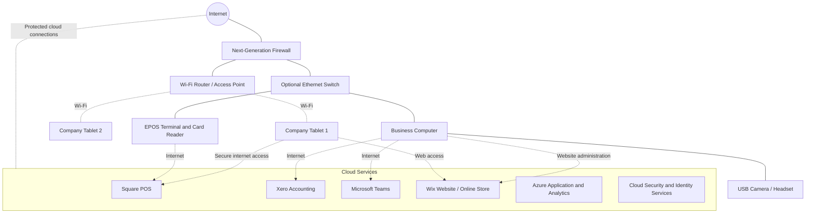

# Digital Transformation Plan for Sam’s Scoops

## 1. Introduction

Digital transformation involves using digital technologies and cloud-based services to improve business processes, customer experiences, communication, and operational efficiency.

Sam’s Scoops is a small ice cream business that wants to modernize its operations. Many processes are still manual, including order-taking, accounting, and supplier communication. The business needs solutions that are affordable, simple to operate, and secure.

The proposed plan uses Software as a Service (SaaS), Microsoft Azure cloud services, and additional network security controls to support the business's growth.

## 2. Existing Network Infrastructure

According to the case study, Sam’s Scoops currently has:

- A Wi-Fi router connected to the internet.
- Two company tablets connected wirelessly.
- Internet access for activities such as online employee training.
- Manual processes for several business functions.

The existing network provides basic connectivity but needs to support additional digital services and protect the increased volume of business and customer data.

## 3. Business Requirements

The business has identified four main functions that need digitization.

| Business function | Current problem | Proposed improvement |
|---|---|---|
| Electronic point of sale (EPOS) | Cash handling and handwritten orders are slow | Digital checkout and card payments |
| Accounting | Financial activities rely on spreadsheets | Cloud accounting and automated financial workflows |
| Supplier communication | Supplier meetings and communication need a suitable interface | Video meetings, chat, and voice calls |
| Website | Limited online promotion and sales capabilities | A business website with potential e-commerce functionality |

Additional recommendations include stronger network security, secure account management, staff training, and regular data backups.

## 4. Step 1 — Recommended SaaS Solutions

SaaS allows users to access cloud-hosted applications through a web browser or an application, reducing the need to install and maintain the underlying software infrastructure themselves.

### 4.1 SaaS Recommendation Table

| Business function | Solution and link | Additional equipment needed? | Three key features | How it is accessed |
|---|---|---|---|---|
| Electronic point of sale | [Square Point of Sale](https://squareup.com/gb/en/point-of-sale) | Compatible card reader; potentially a compatible checkout device | Card payments, payment protection, checkout | Website and app |
| Accounting | [Xero](https://www.xero.com/uk/) | None necessarily; compatible computer or tablet | Pay bills, payroll, send invoices | Website and app |
| Supplier communication | [Microsoft Teams](https://www.microsoft.com/en-gb/microsoft-teams/free) | USB camera if the existing device lacks a suitable camera; microphone or headset if needed | Video calls, instant messaging, voice calls | Web browser and app |
| Website | [Wix](https://www.wix.com/) | None necessarily; a compatible computer for setup | E-commerce, online store, website templates | Web browser |

*These are the example solutions in the course exemplar. Actual equipment requirements, features, availability, and prices depend on the selected plan, region, and compatible devices.*

### 4.2 Electronic Point of Sale — Square

**Purpose:** Replace slow, manual ordering and support digital checkout.

Benefits:

- Accept card payments using compatible payment equipment.
- Digitize the checkout process.
- Help staff process orders more efficiently.

Equipment: A compatible card reader and checkout device may be needed.

### 4.3 Accounting — Xero

**Purpose:** Reduce reliance on manually maintained spreadsheets.

Benefits:

- Manage bills.
- Support payroll processes.
- Send invoices.

A cloud accounting system can help centralize financial information and simplify routine accounting tasks.

### 4.4 Supplier Communication — Microsoft Teams

**Purpose:** Provide an interface for communicating and meeting with suppliers.

Benefits:

- Video meetings.
- Instant messaging.
- Voice calls.

A USB camera may be required if the available computer or other device does not have a suitable camera.

### 4.5 Website — Wix

**Purpose:** Establish an online presence for Sam’s Scoops.

Benefits:

- Create a business website using templates.
- Promote products and business information.
- Add online-store functionality where supported by the selected plan.

A website can help the business reach customers beyond those who visit the physical shop.

## 5. Step 2 — Recommended Microsoft Azure Services

Microsoft Azure provides cloud services that can support applications, analytics, automation, and security.

The course exemplar identifies the following possible uses.

| Azure service or service category | Proposed use | Potential benefit |
|---|---|---|
| Azure Bot | Collect feedback from customers after online purchases | Help identify customer satisfaction and areas for improvement |
| Azure Analytics | Analyze purchasing behavior and business performance | Support better-informed business decisions and targeted offers |
| Azure App Service | Host a web application or customer-facing ordering application | Support online ordering and application deployment |
| Azure security services | Help monitor threats and protect access to business resources | Improve security monitoring and account protection |

### 5.1 Azure Bot

A customer-facing bot could ask customers for feedback about their orders or purchases.

Potential benefits:

- Collect customer feedback.
- Identify recurring customer concerns.
- Help the business understand areas requiring improvement.

### 5.2 Azure Analytics

Analytics services could help Sam examine purchasing patterns and business performance.

Potential benefits:

- Analyze purchase history.
- Identify popular ice cream flavors.
- Understand customer preferences.
- Support targeted promotional offers.

Any analysis involving customer information should follow appropriate privacy and data-protection requirements.

### 5.3 Azure App Service

Azure App Service could support the deployment of a customer-facing web application.

Potential benefits:

- Provide an online ordering interface.
- Support an application that customers can access through the internet.
- Reduce the need for Sam to maintain physical web servers.

A custom application is an optional future development. Sam can initially use an existing SaaS website or e-commerce platform instead of commissioning a bespoke application.

### 5.4 Azure Security Services

Azure security capabilities could help protect cloud resources, monitor suspicious activity, and manage access.

Potential benefits:

- Improve security visibility.
- Help detect potential threats.
- Protect access to cloud resources.
- Support secure identity and credential management.

The precise service must be selected according to the actual security requirement. A cloud security service does not replace the need to secure the shop's local network, devices, and user accounts.

## 6. Step 3 — Recommended Network Security Devices

As the business digitizes its operations, more business and customer data will travel across its network. The network should therefore have stronger protection.

### 6.1 Next-Generation Firewall

**Recommendation:** Add a dedicated next-generation firewall (NGFW) to protect the business network.

Potential capabilities include:

- Inspecting network traffic for suspicious activity.
- Applying rules to control allowed and blocked connections.
- Detecting or preventing certain types of attacks.
- Supporting secure remote access through VPN functionality when configured and supported.

A firewall helps control network traffic, but it does not eliminate every cybersecurity risk.

### 6.2 VPN Connectivity

A virtual private network (VPN) can provide an encrypted connection for authorized remote users accessing supported business resources.

Potential uses include:

- Remote administration.
- Secure access to internal resources.
- Connecting authorized staff to business systems when away from the shop.

Remote access should use strong authentication and least-privilege access rules. A VPN should not automatically grant unrestricted access to the entire network.

### 6.3 Additional Recommended Security Controls

| Control | Purpose |
|---|---|
| Multi-factor authentication (MFA) | Reduce the risk of account compromise |
| Strong, unique passwords | Reduce risks from reused or weak credentials |
| Regular software updates | Address known software vulnerabilities |
| Secure Wi-Fi configuration | Protect wireless access using modern security settings |
| Guest network separation | Prevent guest devices from freely accessing business devices |
| Backups | Help recover important data after accidental deletion or an incident |
| Staff cybersecurity training | Help staff recognize phishing and suspicious requests |
| Access control | Limit each employee to the resources needed for their work |

These controls complement the dedicated firewall and cloud-service security features.

## 7. Step 4 — Proposed Network Diagram

The following logical diagram shows how the existing devices, additional security equipment, and cloud services can be connected.

**Diagram notes:**

- The router and two company tablets represent the existing equipment described in the case study.
- The firewall is the principal proposed additional network security device.
- The Ethernet switch is optional and may be required if the existing router does not provide enough suitable wired ports.
- The EPOS terminal and card reader are proposed additions.
- The computer and camera/headset support accounting, supplier communication, and website administration.
- Cloud services are accessed through the internet; they are not physically located inside the shop.
- The cloud services shown are illustrative. Each SaaS service may be accessed independently over an encrypted connection.
- The diagram does not imply that every cloud service must communicate directly with every other service.

### 7.1 Recommended Network Segmentation

For improved security, Sam’s Scoops should separate business devices from guest devices where the equipment supports this configuration.

A possible arrangement is:

- **Business network:** EPOS terminal, business computer, and authorized company tablets.
- **Guest network:** Customer devices, isolated from internal business devices.
- **Network administration:** Firewall and router management restricted to authorized personnel.

Payment equipment should be configured according to the payment provider's security requirements. Network segmentation can reduce exposure but must be correctly implemented and maintained.

## 8. Implementation Plan

A small business should implement the changes in manageable steps.

| Phase | Main activities | Expected outcome |
|---|---|---|
| 1. Assess | Review existing router, internet service, tablets, devices, and staff needs | Clear understanding of current capabilities |
| 2. Secure | Install or configure the firewall, update devices, enable MFA, and secure Wi-Fi | Stronger baseline security |
| 3. Digitize checkout | Set up the EPOS service and compatible payment equipment | Faster ordering and digital payments |
| 4. Digitize accounting | Configure accounting software and authorized user accounts | More centralized financial workflows |
| 5. Improve communication | Set up supplier communication and test camera/audio equipment | Easier remote meetings |
| 6. Establish website | Publish the business website and evaluate online-store needs | Improved online presence |
| 7. Evaluate cloud services | Determine whether Azure analytics, bots, or custom applications are necessary | Avoid unnecessary complexity and costs |
| 8. Test and train | Test transactions, access permissions, backups, and recovery; train staff | More reliable day-to-day operation |

## 9. Security and Validation Checklist

Before the business relies on the new setup, confirm the following:

- [ ] The firewall is installed or configured correctly.
- [ ] Unnecessary inbound connections are blocked.
- [ ] Wi-Fi uses an appropriate modern security configuration.
- [ ] Business and guest devices are separated where feasible.
- [ ] Staff accounts use strong passwords and MFA where available.
- [ ] Only authorized staff can access financial and payment systems.
- [ ] EPOS transactions and payment equipment have been tested.
- [ ] Cloud services are accessed through secure connections.
- [ ] Data backups and recovery procedures have been tested.
- [ ] Devices and applications receive security updates.
- [ ] Staff know how to identify phishing and report suspicious activity.
- [ ] Staff can contact service providers if a critical cloud service becomes unavailable.

## 10. Expected Benefits

The proposed digital transformation could provide the following benefits:

**Operational efficiency**
- Faster checkout and order processing.
- Less reliance on handwritten records.
- More organized accounting activities.

**Customer experience**
- Convenient card payments.
- Better online visibility.
- Potential future online ordering.

**Communication**
- Easier supplier meetings through video, voice, and chat.
- Improved coordination with business partners.

**Business insights**
- Better visibility into purchasing patterns.
- More informed decisions about products and promotions.

**Security**
- Improved traffic filtering through a firewall.
- Stronger access controls.
- Better protection of business information through appropriate cloud and device security practices.

## 11. Conclusion

Sam’s Scoops can modernize its business by combining SaaS applications, selected Azure services, and improved network security.

Square can support electronic point of sale, Xero can support accounting, Microsoft Teams can facilitate supplier communication, and Wix can provide a business website. Azure services may be useful as the business grows and develops more advanced analytics or custom applications.

A next-generation firewall, secure account management, appropriate network separation, and reliable backups can help protect the expanded environment.

The best implementation is one that meets the business's immediate needs without adding unnecessary technical complexity or cost. Security, usability, and scalability should remain central to every decision.